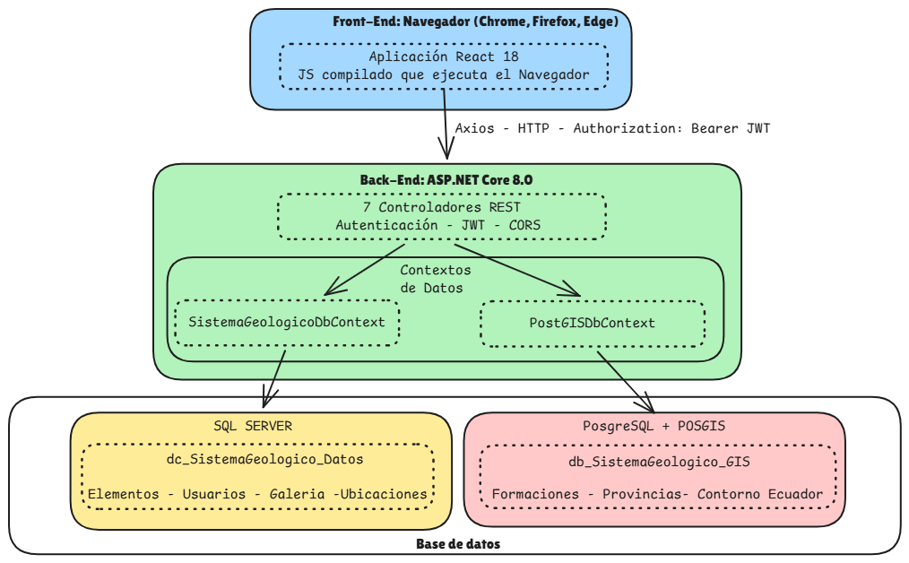

# Sistema Geológico

# Front-End Web — Catálogo y Visualización Georreferenciada de Muestras Geológicas

> Aplicación web para la gestión, consulta y visualización cartográfica de fósiles, minerales y rocas del Museo Petrográfico "Tomás Feininger" del Departamento de Geología de la Escuela Politécnica Nacional.

---

## Información General

| Campo | Información |
|--------|-------------|
| Institución | Escuela Politécnica Nacional (EPN) |
| Facultad | Facultad de Ingenieria Electrica y Electrónica (FIEE) |
| Carrera | Ingeniería de Tecnologías de la Información  |
| Asignatura | Trabajo de Integración Curricular |
| Autor | Miguel David Pastuña Gavilanez |
| Director | Raúl David Mejía Navarrete  |
| Año | 2026 |
| Versión | 1.0 |

---

# Tabla de Contenidos

- [Descripción del Proyecto](#descripción-del-proyecto)
- [Objetivos](#objetivos)
- [Alcance](#alcance)
- [Tecnologías Utilizadas](#tecnologías-utilizadas)
- [Arquitectura](#arquitectura)
- [Licencias](#licencias)

---

# Descripción del Proyecto

El Museo Petrográfico "Tomás Feininger" del Departamento de Geología de la EPN no contaba con un sistema digital que permitiera catalogar, consultar y georreferenciar su colección de fósiles, minerales y rocas; el registro dependía de medios físicos y hojas de cálculo desconectadas entre sí, sin visualización cartográfica ni control de acceso diferenciado por tipo de usuario.

Este proyecto desarrolla un sistema web compuesto por un Front-End (React + Vite) y un Back-End (ASP.NET Core 10) que digitaliza el catálogo de muestras y lo integra con un módulo de mapas interactivos sobre la cartografía geológica oficial del Ecuador (capas GIS en PostGIS). La solución permite registrar cada muestra con su ficha petrográfica, ubicarla geográficamente sobre el mapa geológico nacional, gestionar su galería fotográfica con protección diferenciada por rol, y administrar el acceso de usuarios según su perfil (Administrador, Premium, Free), todo dentro de un mismo flujo de navegación.

---

# Objetivos

## Objetivo General

- Desarrollar un Front-End de un sistema distribuido para presentar de forma interactiva las muestras geológicas y los recursos asociados al Museo Petrográfico "Tomás Feininger" del Departamento de Geología de la Escuela Politécnica Nacional.

## Objetivos Específicos

- Garantizar la correcta visualización georreferenciada de todas las muestras geológicas del museo a través del módulo de mapas interactivos que muestre información detallada de los datos petrográficos y recursos visuales.
- Asegurar el funcionamiento efectivo de las restricciones de acceso donde los permisos diferenciados por tipo de usuario —Administrador, Usuario de Paga y Usuario Gratuito— operen correctamente.
- Permitir a todos los usuarios la búsqueda y filtrado avanzado de muestras específicas en base a criterios como tipo de muestra, subtipo de muestra y localización, con resultados sincronizados tanto en la lista como en el mapa interactivo.

---

# Alcance

**Incluido en esta versión:**

- Catálogo unificado de fósiles, minerales y rocas con ficha petrográfica, galería fotográfica y ubicación geográfica.
- Módulo de mapas interactivos con tres vistas (Normal, Geológica y Combinada) sobre las capas GIS del mapa geológico nacional del Ecuador.
- Autenticación JWT con bloqueo de cuenta tras intentos fallidos, y control de acceso en dos niveles (rutas protegidas + menú lateral condicionado por rol).
- Marca de agua diferenciada por rol sobre las fotografías, aplicada en el servidor.
- Búsqueda y filtrado combinado por tipo, subtipo, país, provincia, localidad y nombre, sincronizado en tiempo real entre la tabla y el mapa.
- Gestión administrativa de usuarios y carga masiva de elementos desde Excel.
- Solicitud de informe petrográfico por correo electrónico desde la vista de detalle.

**Fuera del alcance de esta versión** (ver recomendaciones para trabajo futuro):

- Diseño responsivo para dispositivos móviles y tabletas.
- Entrega y publicación del informe petrográfico final dentro del propio sistema (actualmente requiere un proceso externo).
- Búsqueda por proximidad geográfica (radio configurable sobre el mapa).
- Modo de trabajo sin conexión (PWA / *service workers*).
- Exportación del catálogo a Excel/CSV y generación de fichas individuales en PDF.
- Roles adicionales más allá de Administrador, Premium y Free (p. ej., un rol Investigador).

---

# Tecnologías Utilizadas

| Tecnología | Versión |
|------------|---------|
| ASP.NET Core | 10.0 |
| Entity Framework Core (Npgsql) | 10.0 |
| React | 18.3.1 |
| Vite | 6.0.3 |
| Material-UI (MUI) | 6.4.3 |
| Leaflet / react-leaflet | 1.9.4 / 4.2.1 |
| Axios | 1.7.9 |
| react-router-dom | 7.1.0 |
| NetTopologySuite | 2.6.0 |
| Npgsql.EntityFrameworkCore.PostgreSQL | 10.0.3 |
| SkiaSharp (marca de agua) | 4.154.0 |
| MailKit | 4.18.2 |
| PostgreSQL + PostGIS | 18 / 3.6 |
| Docker Compose + Caddy | — / 2.10.2 |

---

# Arquitectura

El sistema separa Front-End y Back-End en dos proyectos independientes que se comunican vía HTTP/JSON.

El **Back-End** (`Servidor_Sistema_Geologia/`) sigue el patrón Repository + Service + Controller: un controlador unificado (`ElementosGeologicosController`) expone fósiles, minerales y rocas mediante herencia TPH (*Table-Per-Hierarchy*) sobre una entidad base auditable. Usa un servidor PostgreSQL + PostGIS con dos bases: una para identidad y operaciones CRUD, y otra para las capas espaciales del mapa geológico.

El **Front-End** (`Cliente_Sistema_Geologia/cliente-sistema-geologico/`) sigue un patrón Página-Componente con Context API: cada contexto (`AuthContext`, `ElementosContext`, `GeologiaContext`, `UsersContext`, etc.) encapsula su propio *hook* de servicio HTTP, y las páginas delegan toda la lógica de negocio a su contexto, dejando los componentes como UI pura.

El siguiente diagrama ilustra el flujo de construcción y ejecución: en desarrollo, Node.js 20 y pnpm gestionan las dependencias mientras Vite convierte JSX a JS/HTML/CSS (`pnpm dev` con HMR, o `pnpm build` para empaquetar); en producción, el navegador solo descarga los archivos estáticos de `dist/` (HTML, JS y CSS ya compilados) sin depender de Node, Vite ni pnpm, mientras el Back-End se distribuye como binarios `.dll` generados por el SDK de .NET 8 y se ejecuta sobre el puerto 5095 sin requerir su código fuente en el servidor.



> El diagrama corresponde a la ejecución sin contenedores. Desde el 2026-11-03 la base de datos, el Back-End y el Front-End corren en contenedores Docker separados (ver `docs/diagramas/entornos.md`).

---

# Ejecución

Requiere solo git y Docker.

```bash
docker compose up -d --build
docker compose run --rm api dotnet run --no-launch-profile -- --migrate
```

Front-End en `http://localhost:5174`, API en `http://localhost:5095/swagger`. Guía completa: `docs/arquitectura/reconstruir-desde-cero.md`; producción en un servidor: `docs/despliegue/vps-docker.md`.

---

# Licencia

Este proyecto fue desarrollado con fines académicos como parte del Trabajo de Integración Curricular de la carrera Ingenieria de Tecnologías de la Información.

Su distribución y uso quedan sujetos a la normativa institucional correspondiente.
