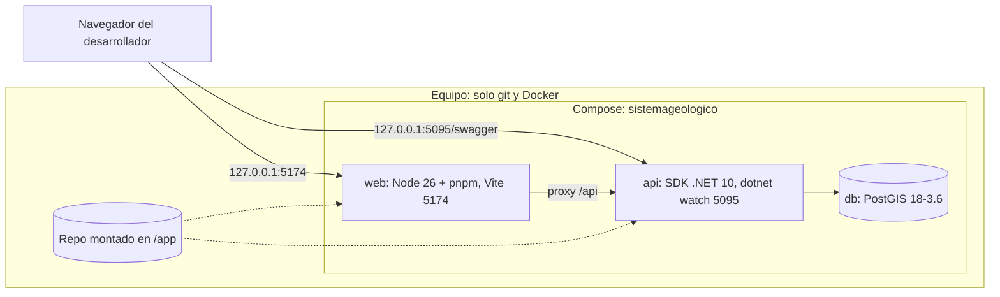
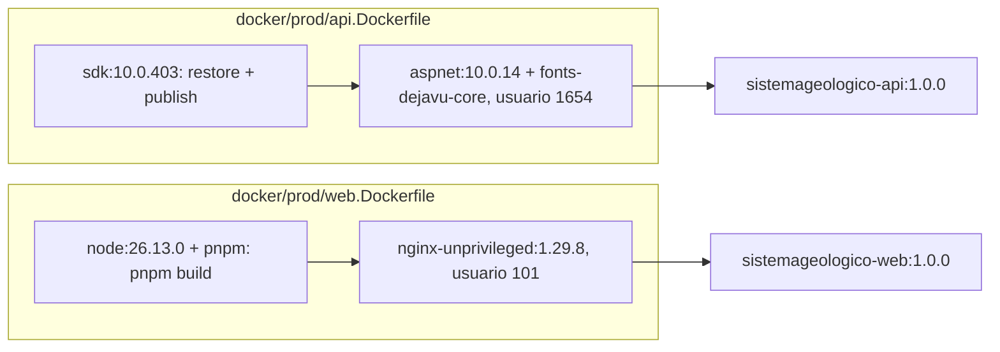
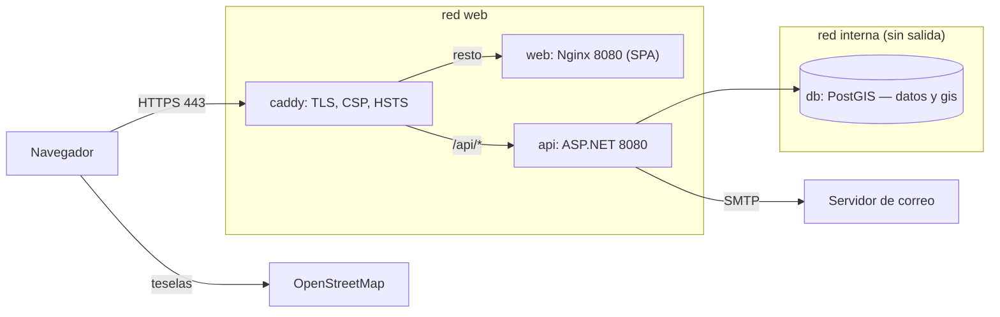

# DIA-08 · Entornos y despliegue

**Qué muestra:** los contenedores de desarrollo, el empaquetado de las
imágenes de producción y el camino de una petición en producción.

**Sale de:** `compose.yaml`, `compose.prod.yaml`, `Caddyfile`,
`docker/dev/*.Dockerfile`, `docker/prod/*`, `docker/db/init/` (commit
`8dfe171`).

**Texto que lo explica:** [ARQ-03](../arquitectura/stack-y-entornos.md) y
[DEP-01](../despliegue/vps-docker.md); índice [DIA-00](indice.md).

## Desarrollo (`compose.yaml`)

## Empaquetado de producción

## Una petición en producción (`compose.prod.yaml`)

La migración no corre al arrancar: es el paso explícito
`docker compose -f compose.prod.yaml run --rm api --migrate`.
