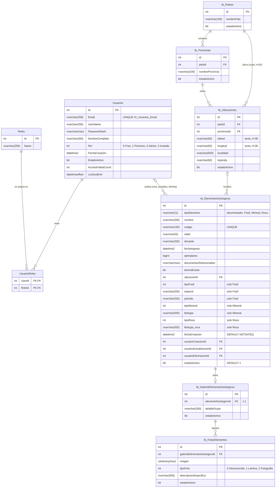
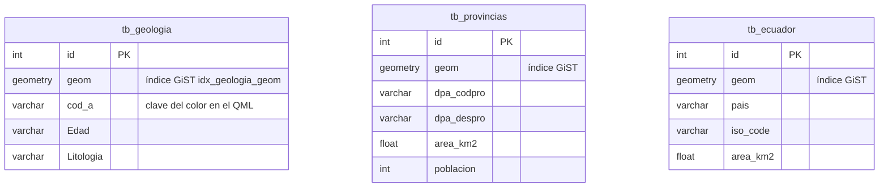

# DIA-03 · Modelo de datos

**Qué muestra:** las tablas del catálogo y la identidad (SQL Server) y las
capas GIS (PostgreSQL + PostGIS), con tipos, claves y cardinalidades.

**Sale de:** `Servidor_Sistema_Geologia/DAL/SistemaGeologicoDbContext.cs`,
`DAL/PostGISDbContext.cs`, `Models/`, las seis migraciones de `Migrations/`
y `SistemaGeologicoDbContextModelSnapshot.cs` (commit `d30f189`).

**Texto que lo explica:** [ARQ-01](../arquitectura/diagrama.md) y
[REV-01](../revisiones/2026-11-03-sistema-completo.md); índice
[DIA-00](indice.md).

## SQL Server (catálogo e identidad)

Las seis tablas `tb_*` heredan de `EntidadAuditable`: además de lo dibujado,
cada una tiene `fechaCreacion`, `fechaActualizacion`, `fechaEliminacion`,
`usuarioCreacionId`, `usuarioActualizacionId` y `usuarioEliminacionId`, con
FK a `Usuarios` (`ON DELETE RESTRICT`). En el diagrama solo se dibuja esa
relación para `tb_ElementosGeologicos`. Identity agrega `UsuarioClaims`,
`UsuarioLogins`, `UsuarioTokens` y `RolClaims`, que el código no usa.

## PostgreSQL + PostGIS (capas, solo lectura)

Las tres tablas no se relacionan entre sí ni con el catálogo: el cruce entre
un elemento y su formación lo hace el cliente sobre el mapa. Los tipos de
texto salen de los `[MaxLength]` de `Models/GIS/`; el esquema real no está en
el repo (REV-01, H-04).

## Diccionario

| Tabla | Propósito | Restricciones e índices |
|---|---|---|
| `Usuarios` | cuentas (Identity) con rol y estado | `IX_Usuarios_Email` único; bloqueo con `AccessFailedCount`/`LockoutEnd` |
| `Roles`, `UsuarioRoles` | roles de Identity; copia del rol que no se mantiene (H-07) | PK compuesta `(UserId, RoleId)` |
| `tb_Paises`, `tb_Provincias` | catálogo geográfico; las provincias se crean al vuelo al dar de alta un elemento | FK `paisId`, `RESTRICT` |
| `tb_Ubicaciones` | punto y localidad de un elemento | FK a país y provincia, `RESTRICT`; defaults 1 sin filas sembradas (H-03) |
| `tb_ElementosGeologicos` | fósiles, minerales y rocas en una tabla (TPH) | `IX_ElementosGeologicos_Codigo` único; `nombre` y `codigo` `NOT NULL` |
| `tb_GaleriaElementosGeologicos` | una galería por elemento | FK única a elemento, `CASCADE` |
| `tb_FotosElementos` | imágenes en la base | FK a galería, `CASCADE` |
| `tb_geologia`, `tb_provincias`, `tb_ecuador` | capas importadas de QGIS | índices GiST sobre `geom` |

## Estrategia de persistencia

- **Migraciones:** EF Core, solo para SQL Server; dos de las seis contienen
  T-SQL a mano. No hay `Database.Migrate()` al arrancar: se aplican con
  `dotnet ef database update`. PostGIS no tiene migraciones.
- **Borrado:** lógico (`estadoActivo = false`, con fecha y usuario) para
  elementos, fotos y usuarios; los `CASCADE` solo actúan en un borrado físico,
  que el código no hace.
- **Transacciones:** ninguna explícita; cada `SaveChangesAsync` es su propia
  transacción, y el alta de un elemento usa varias (H-08).
- **Concurrencia:** sin control optimista en las tablas del catálogo (no hay
  `rowversion`); Identity usa su `ConcurrencyStamp` en usuarios y roles. Gana
  la última escritura.
