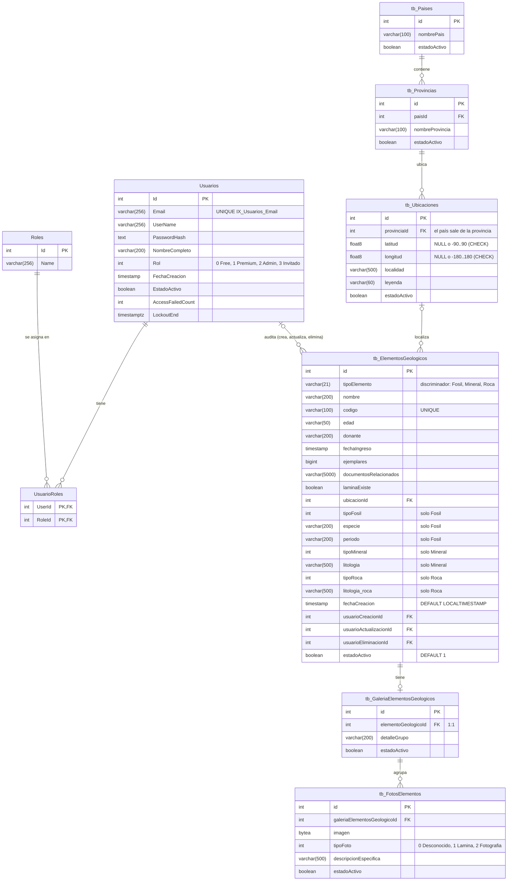
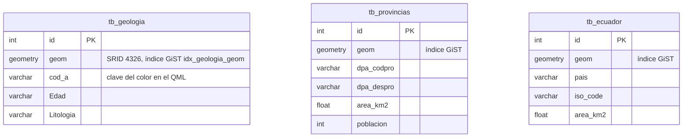

# DIA-03 · Modelo de datos

**Qué muestra:** las tablas de las dos bases del servidor PostgreSQL:
`sistemageologico_datos` (catálogo e identidad) y `sistemageologico_gis`
(capas), con tipos, claves y cardinalidades.

**Sale de:** `Servidor_Sistema_Geologia/DAL/SistemaGeologicoDbContext.cs`,
`DAL/PostGISDbContext.cs`, `Models/`,
`Migrations/` (`InitialPostgres`, `UbicacionPaisDesdeProvinciaYCoordenadasNumericas`,
`RolSoloEnColumnaUsuarios`) y `docker/db/init/01-bases-y-capas-gis.sh` (commit `e3d2880`). Hasta `d30f189`
el catálogo estaba en SQL Server (REV-01).

**Texto que lo explica:** [ARQ-01](../arquitectura/diagrama.md) y
[REV-01](../revisiones/2026-11-03-sistema-completo.md); índice
[DIA-00](indice.md).

## `sistemageologico_datos` (catálogo e identidad)

Las seis tablas `tb_*` heredan de `EntidadAuditable`: además de lo dibujado,
cada una tiene `fechaCreacion`, `fechaActualizacion`, `fechaEliminacion`,
`usuarioCreacionId`, `usuarioActualizacionId` y `usuarioEliminacionId`, con
FK a `Usuarios` (`ON DELETE RESTRICT`). En el diagrama solo se dibuja esa
relación para `tb_ElementosGeologicos`. Identity agrega `UsuarioClaims`,
`UsuarioLogins`, `UsuarioTokens` y `RolClaims`, que el código no usa.

## `sistemageologico_gis` (capas, solo lectura para la aplicación)

Las tres tablas no se relacionan entre sí ni con el catálogo: el cruce entre
un elemento y su formación lo hace el cliente sobre el mapa. Las crea vacías
`docker/db/init/01-bases-y-capas-gis.sh` con los tipos de `Models/GIS/` y
SRID 4326; los datos del IIGE no están en el repo (PEN-04).

## Diccionario

| Tabla | Propósito | Restricciones e índices |
|---|---|---|
| `Usuarios` | cuentas (Identity) con rol y estado | `IX_Usuarios_Email` único; bloqueo con `AccessFailedCount`/`LockoutEnd` |
| `Roles`, `UsuarioRoles` | tablas que `AddIdentity` exige; vacías y sin uso: el rol vive solo en `Usuarios.Rol` | PK compuesta `(UserId, RoleId)` |
| `tb_Paises`, `tb_Provincias` | catálogo geográfico; países y provincias se crean al vuelo al dar de alta un elemento; cada país tiene una provincia "Desconocida"; la semilla crea "Desconocido"/"Desconocida" | FK `paisId`, `RESTRICT` |
| `tb_Ubicaciones` | punto y localidad de un elemento | FK a provincia (`RESTRICT`); el país es el de la provincia; sin provincia se usa la "Desconocida" de ese país; coordenadas nulas si se desconocen, con `CHECK` de rango |
| `tb_ElementosGeologicos` | fósiles, minerales y rocas en una tabla (TPH) | `IX_ElementosGeologicos_Codigo` único; `nombre` y `codigo` `NOT NULL` |
| `tb_GaleriaElementosGeologicos` | una galería por elemento | FK única a elemento, `CASCADE` |
| `tb_FotosElementos` | imágenes en la base | FK a galería, `CASCADE` |
| `tb_geologia`, `tb_provincias`, `tb_ecuador` | capas del mapa geológico (vacías hasta cargar los datos) | índices GiST sobre `geom`; dueño `postgres` |

## Estrategia de persistencia

- **Migraciones:** EF Core con Npgsql, solo para `sistemageologico_datos`; tres
  migraciones (2026-11-03). `UbicacionPaisDesdeProvinciaYCoordenadasNumericas`
  usa SQL explícito (`ALTER ... TYPE ... USING`, normaliza vacíos y `0.0/0.0`
  a `NULL`) y su `Down` se probó ida y vuelta. Se aplican con el
  paso explícito `--migrate`, nunca al arrancar. La base GIS no tiene
  migraciones: su esquema está en el script de init.
- **Fechas:** `timestamp without time zone` con hora local
  (`DateTime.Now`), mediante `Npgsql.EnableLegacyTimestampBehavior` en
  `Program.cs`.
- **Permisos:** el rol de la aplicación es dueño de `sistemageologico_datos`
  y solo tiene `SELECT` en `sistemageologico_gis`.
- **Borrado:** lógico (`estadoActivo = false`, con fecha y usuario) para
  elementos, fotos y usuarios; los `CASCADE` solo actúan en un borrado físico,
  que el código no hace.
- **Transacciones:** el alta de un elemento guarda el grafo (ubicación,
  provincia y país nuevos, elemento y galería) en un solo `SaveChangesAsync`.
  La carga masiva usa `IUnitOfWork`: transacción explícita, todo o nada.
- **Concurrencia:** sin control optimista en las tablas del catálogo; Identity
  usa `ConcurrencyStamp` en usuarios. Gana la última escritura, y un `Update`
  de entidad completa puede deshacer un borrado lógico concurrente (REV-02,
  H-03; PEN-12).
