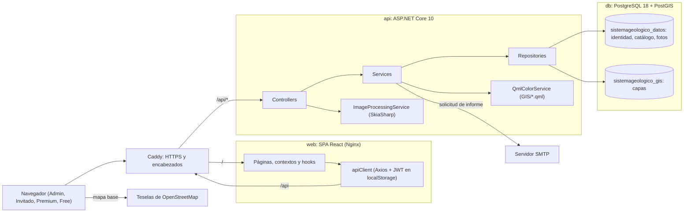

# DIA-01 · Vista general

**Qué muestra:** las piezas del sistema y cómo se comunican, en producción.

**Sale de:** `Servidor_Sistema_Geologia/Program.cs`, `Caddyfile`,
`compose.prod.yaml`, `src/lib/apiClient.js`,
`Services/Implementation/EmailService.cs`,
`Services/Implementation/ImageProcessingService.cs`,
`src/constants/mapConstants.js` (commit `8dfe171`).

**Texto que lo explica:** [ARQ-01](../arquitectura/diagrama.md); entornos en
[DIA-08](entornos.md); índice [DIA-00](indice.md).

En desarrollo, el proxy de Vite ocupa el lugar de Caddy (DIA-08).
