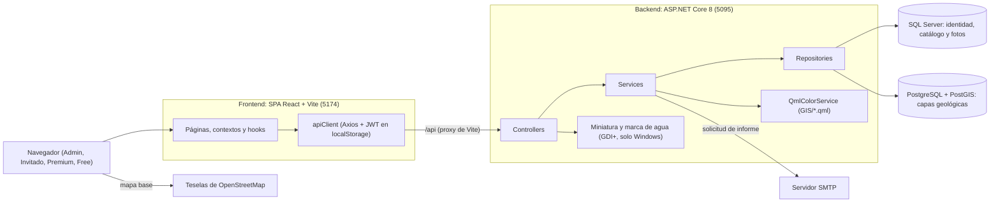

# DIA-01 · Vista general

**Qué muestra:** las piezas del sistema y cómo se comunican hoy, en desarrollo
local.

**Sale de:** `Servidor_Sistema_Geologia/Program.cs`,
`Cliente_Sistema_Geologia/cliente-sistema-geologico/vite.config.js`,
`src/lib/apiClient.js`, `Services/Implementation/EmailService.cs`,
`src/constants/mapConstants.js`.

**Texto que lo explica:** [ARQ-01](../arquitectura/diagrama.md); índice
[DIA-00](indice.md).

